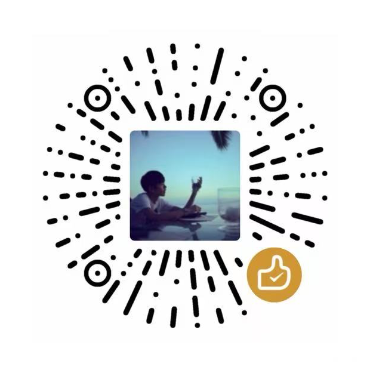
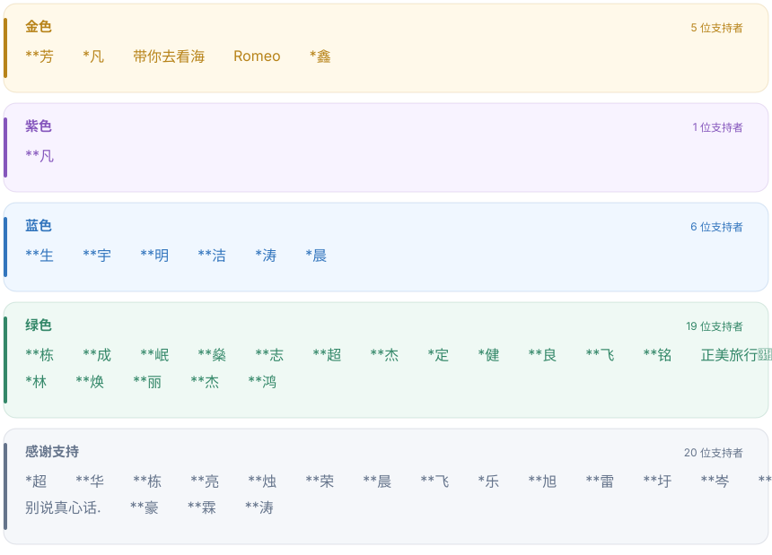

# ☕ 请我喝杯咖啡

**简体中文** · [English](README.en.md)

[CarWithin](https://github.com/xmz28/CarWithin) · [Ninebot Pro](https://github.com/xmz28/ninebot_pro)

这两个项目最初是我出于兴趣做的小工具。感谢大家分享使用体验，帮我发现不同设备上的连接、兼容和投屏问题。

两个项目目前都可以免费使用。代码和安装包托管在 GitHub，网页使用 GitHub Pages。我用来辅助开发的 **AI 工具每年约 1,500 元**，平时也会花时间做设备适配、实机测试、修复问题和维护文档。

如果这些工具帮到了你，欢迎请我喝杯咖啡。

| 支付宝收款码 | 微信赞赏码 |
| :---: | :---: |
|  |  |
| [打开支付宝链接](https://qr.alipay.com/fkx16608y1puemmltuocze0) | [查看微信赞赏码大图](assets/wechat.png) |

**赞赏完全自愿，下载、使用和更新照常。** 给项目点个 Star、分享给有需要的朋友，或反馈问题，也是在支持。

[返回 GitHub 个人主页](https://github.com/xmz28)

## 感谢每一份支持

每一份支持，都在帮助这些小工具继续前进。**83 个展示条目** · 记录截止 2026-11-27 08:32（北京时间）

名字之间留白排列，昵称颜色按累计赞赏金额区分，仅用于表达感谢；不公开金额或头像。[查看 App 同步名单](supporters.json)。

展开文字名单（可搜索昵称）

**金色**

\*\*芳　\*凡　带你去看海　Romeo　\*鑫

**紫色**

\*\*凡　\*\*源　\*\*森　你好难哄

**蓝色**

\*\*生　\*\*宇　\*\*明　\*\*洁　\*涛　\*晨　\*\*飞　\*胤　\*辉　伏月　澪空　龙辰名表

**绿色**

\*\*栋　\*\*成　\*\*岷　\*\*燊　\*\*志　\*\*超　\*\*杰　\*定　\*健　\*\*良　\*\*飞　\*\*铭　正美旅行🤿海岛潜水 Ryan　\*\*明　\*林　\*\*焕　\*\*丽　\*\*杰　\*\*鸿　\*\*容　\*\*易　\*\*华　\*\*勇　\*\*鹏　\*\*海　\*\*旭　\*\*杰　\*\*钧　Aa

**感谢支持**

\*超　\*\*华　\*\*栋　\*\*亮　\*\*烛　\*\*荣　\*\*晨　\*\*飞　\*乐　\*\*旭　\*\*雷　\*\*圩　\*\*岑　\*\*阳　\*\*庆　z　别说真心话.　\*\*豪　\*\*霖　\*\*涛　\*\*庭　\*\*\*\*.\*\*依　\*\*程　\*凡　\*\*武　\*进　\*晨　\*\*豪　\*\*铭　。　DD　〉　匿名支持者

